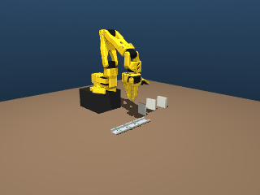
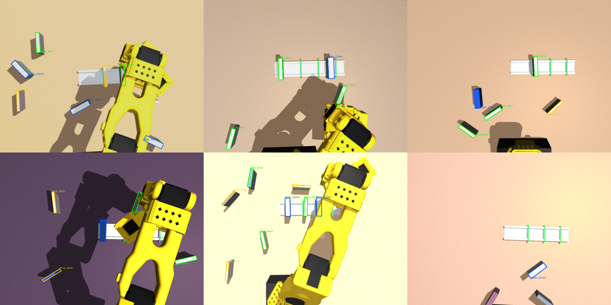

# SO-101 DIN-Rail Terminal Block Picker

Vision-guided pick-and-place of DIN-rail terminal blocks in **three widths (5.2 / 8.2 / 12.2 mm)**
with the low-cost 6-DoF **SO-101** arm (Feetech STS3215 servos, LeRobot ecosystem).
The project compares a **classic pipeline** (calibrated camera, my own kinematics and IK) with
**imitation learning** (ACT). Everything is built and measured in simulation first, so it is ready
to run on the real arm.



> **Status:** work in progress, built in simulation first. The real-arm phase comes last.
> All numbers below come from **simulation and synthetic images** unless marked otherwise.

---

## Results so far

| Area | Result |
|---|---|
| Forward kinematics (own, NumPy) | Matches MuJoCo to **< 1e-9 m** on 500 random poses; matches ROS `robot_state_publisher` and the official URDF |
| Jacobian + damped-least-squares IK | Jacobian validated against `mj_jacSite` and finite differences |
| Scripted pick-and-place (sim, ground-truth poses) | **60/60 blocks seated**: 20 episodes × 3 widths, ±1 cm / ±10° randomisation; max error 1.4 mm along / 0.7 mm across the rail |
| C++ safety monitor (ROS 2) | Overheat, sustained overload, under-voltage and telemetry dropout all stop motion; latched fault, reset only when safe; 9 gtest unit tests |
| Camera calibration (real laptop webcam) | **0.305 px** RMS reprojection error, 24 images (1 outlier rejected automatically) |
| Block detector, YOLO26n-OBB (synthetic test set, 300 images / 1383 blocks) | Recall **99.2 %**, precision **98.8 %**, width class correct **99.7 %**, centre error **0.12 mm** median (0.51 mm p95), rotation error **0.14°** median (0.59° p95), 5.9 ms per image on an RTX 3050 Ti |

## Project status

- [x] **Phase 1, Setup:** WSL2 Ubuntu 24.04, ROS 2 Jazzy, MuJoCo, LeRobot, GPU rendering
- [x] **Phase 2, Simulation:** own FK, Jacobian, IK; DIN-rail scene; scripted pick-and-place
- [x] **Phase 3, ROS 2:** URDF + RViz, ros2_control (mock hardware), C++ safety monitor
- [ ] **Phase 4, Perception**
  - [x] 4.1 Camera intrinsic calibration (Zhang's method, robust outlier rejection)
  - [x] 4.2 Synthetic, domain-randomised dataset + YOLO26-OBB detector
  - [ ] 4.3 Pixel → 3D grasp pose
  - [ ] 4.4 Hand-eye calibration (in simulation, then on the real arm)
  - [ ] 4.5 Pick-and-place driven by the camera instead of ground truth
- [ ] **Phase 5, Imitation learning (sim):** demonstrations as a LeRobot dataset, ACT training, comparison with the classic pipeline
- [ ] **Phase 6, Write-up:** results table, video
- [ ] **Phase 7, Real SO-101:** assembly, Feetech ros2_control driver, real trials, sim-to-real comparison

---

## How it works

### 1. Kinematics (Phase 2): `sim/so101_sim/`
- **Forward kinematics** as a product of homogeneous transforms (fixed link offset × joint rotation
  via Rodrigues' formula), with the parameters read from the MJCF. The math is my own code.
- **Geometric Jacobian** (`J_v = z_i × (p_tcp − p_i)`, `J_w = z_i`) and **damped-least-squares IK**
  with step clamping, joint-limit clipping and random restarts.
- **5-DoF insight:** top-down grasps at any yaw are still possible, because the three pitch joints
  are parallel (3 position + 1 pitch + 1 yaw = 5 constraints).
- **Workspace-driven cell design:** I mapped the dexterous workspace for top-down grasps. The TCP
  can only reach about 8 cm above the base (wrist-flex limit), so the arm stands on an **8 cm riser**
  to gain about 15 cm of usable height.

### 2. Scripted pick-and-place (Phase 2): `sim/so101_sim/pick_place.py`
Approach, descent and retreat are **straight Cartesian lines**, with IK solved every 5 mm and a
smoothstep timing law. The gripper **pre-shapes** to the block width + 10 mm so the swinging jaw
can't hit neighbouring blocks, uses a **measured in-hand offset** (the fixed jaw sits 21 mm from
the TCP), and releases gently (open slightly, back off 2 mm, lift).
Debugging lessons are documented in the commits: contact logging found a sign error, and too few
solver iterations made blocks "walk" on the rail (a simulation artefact, not a controller bug).

### 3. ROS 2 stack (Phase 3, ROS 2 Jazzy): `ros2_ws/src/`
| Package | What it does |
|---|---|
| `so101_description` | URDF imported reproducibly from SO-ARM100, own `tcp_link` matching the sim TCP (the official frame differs by 2 cm), RViz launch |
| `so101_bringup` | ros2_control: mock hardware (replaced by a Feetech driver later), joint trajectory controller and gripper controller |
| `so101_interfaces` | `ServoTelemetry` message: load, temperature and voltage per servo |
| `so101_safety` | **C++** safety monitor: debounced overload, temperature, voltage, fail-safe telemetry timeout; latched fault; stop-category-2-style stop through the controller manager; reset only when safe. The rules live in a ROS-free class covered by gtest |

The fake telemetry node uses a first-order thermal model (temperature rise ∝ load²), so faults can
be injected and tested before any hardware exists.

### 4. Perception (Phase 4): `perception/so101_perception/`
- **Calibration:** pinhole + Brown-Conrady model, results saved in **ROS camera_info YAML** format.
  Bad photos are removed by a homography pre-filter and per-view outlier rejection.
- **Synthetic data:** 3000 images of the MuJoCo scene, rendered at 960 × 720, with **domain
  randomisation**: lighting, table colour, camera pose and FOV, block count, position, rotation and
  colour, arm pose and occlusions, blur and noise. Labels are exact **oriented boxes of each block's
  top face**, which give the grasp centre and angle directly.
- **Detector:** YOLO26n-OBB (2.4 M parameters), fine-tuned from pretrained weights, 60 epochs (about 2 h on a 4 GB laptop GPU).
- **Evaluation for grasping:** besides mAP, it reports recall, the width-class confusion matrix,
  and **centre error in mm and rotation error in degrees**, converted per block from its known 45 mm length.



**Honest limitation:** the detector numbers come from synthetic test images. Performance on real
photos (the sim-to-real gap) will be measured with hand-labelled photos of real blocks.

---

## Repository layout
```
sim/            MuJoCo models (SO-101 from MuJoCo Menagerie + DIN-rail scenes) and so101_sim package
  so101_sim/    kinematics.py, ik.py, scene.py, pick_place.py
  scripts/      demos (IK, scene viewer, pick-and-place runs)
  tests/        pytest: FK, Jacobian/IK, scene, pick-and-place, URDF<->MJCF consistency
perception/     so101_perception package: calibration.py, synthetic.py
  scripts/      checkerboard PDF, capture (Windows), calibration, dataset generation, YOLO train/eval
  calibration/  camera calibration results (ROS camera_info YAML)
ros2_ws/src/    ROS 2 packages (description, bringup, interfaces, safety)
experiments/    trial logs (CSV)
media/          GIFs and images for this README
```

## Quick start
Tested on Windows 11 + WSL2 (Ubuntu 24.04), Python 3.12, ROS 2 Jazzy, RTX 3050 Ti 4 GB.
```bash
# Python side (simulation, perception)
uv venv --python 3.12 .venv && source .venv/bin/activate
uv pip install -r requirements-lock.txt && uv pip install -e .
pytest -q                                              # 23 tests
python sim/scripts/run_pick_place.py --viewer          # watch the scripted pick-and-place
python sim/scripts/run_pick_place.py --episodes 20     # success rate -> experiments/

# ROS 2 side (separate terminal, without the venv)
source /opt/ros/jazzy/setup.bash && cd ros2_ws
colcon build --symlink-install && source install/setup.bash
colcon test --packages-select so101_safety            # C++ unit tests
ros2 launch so101_bringup bringup.launch.py            # robot + controllers + RViz
ros2 launch so101_safety safety.launch.py              # safety monitor + simulated telemetry
```

## Tech stack
Python, NumPy, MuJoCo · ROS 2 Jazzy, ros2_control, rclcpp (C++17), gtest · OpenCV ·
Ultralytics YOLO26-OBB, PyTorch · LeRobot (ACT, coming next) · WSL2

## Credits and licences
- SO-101 URDF and meshes: [TheRobotStudio/SO-ARM100](https://github.com/TheRobotStudio/SO-ARM100) (Apache-2.0)
- SO-101 MJCF: [MuJoCo Menagerie](https://github.com/google-deepmind/mujoco_menagerie) (Apache-2.0)
- Ultralytics YOLO: AGPL-3.0
- Code in this repository: see [LICENSE](LICENSE)
