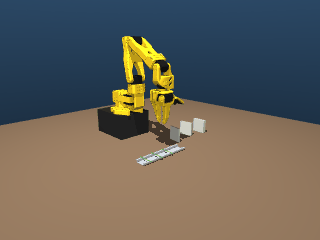
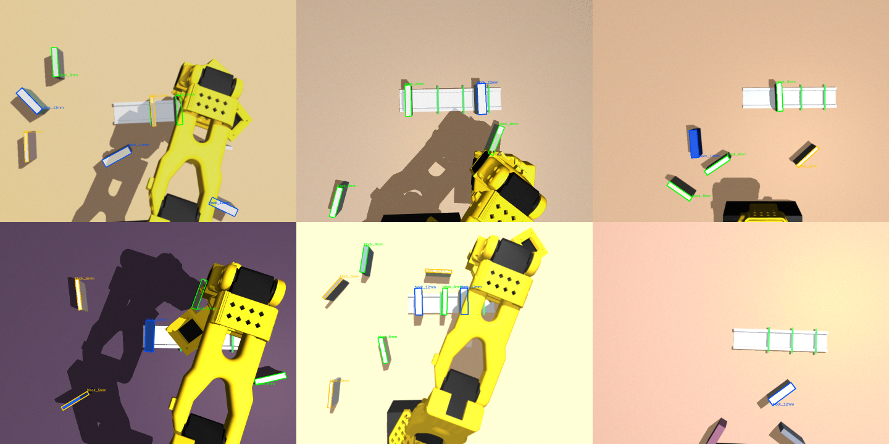
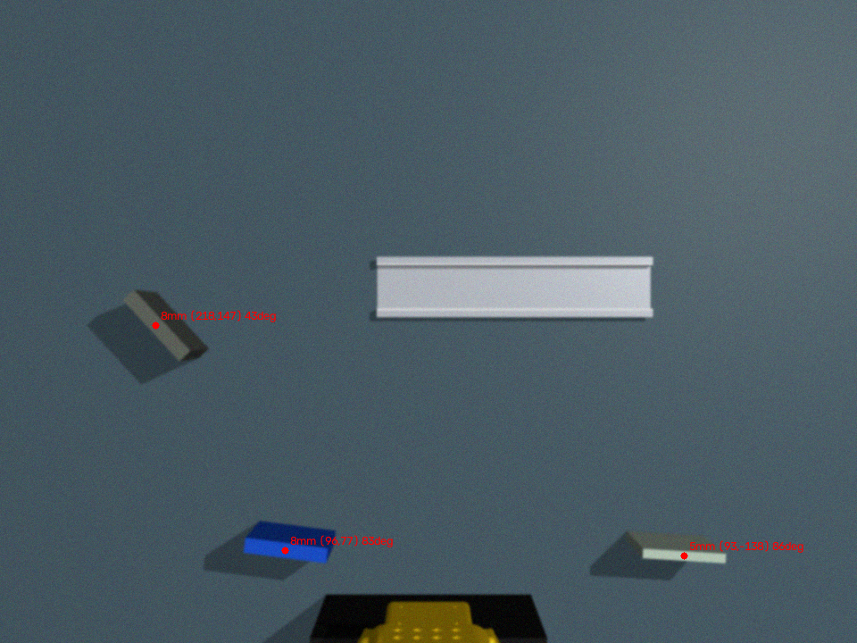
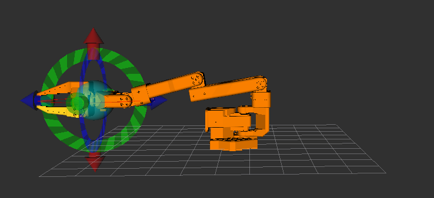

# SO-101 DIN-Rail Terminal Block Picker

Vision-guided pick-and-place of DIN-rail terminal blocks in **three widths (5.2 / 8.2 / 12.2 mm)**
with the low-cost **SO-101** arm (5 arm joints + gripper, Feetech STS3215 servos, LeRobot ecosystem).
The project compares a **classic pipeline** (calibrated camera, my own kinematics and IK, MoveIt 2)
with **imitation learning** (ACT).

The robot is built as a **hardware-realistic digital twin** on a laptop: every software layer is
written so that it runs unchanged on a real arm, and the gap between ideal and realistic simulation is
measured. A real arm is an optional final phase. See [ROADMAP.md](ROADMAP.md).



> **Status:** work in progress. All numbers below come from **simulation and synthetic images**
> unless marked **(real)**.

---

## Results so far

| Area | Result |
|---|---|
| Forward kinematics (own, NumPy) | Matches MuJoCo to **< 1e-9 m** on 500 random poses; matches ROS `robot_state_publisher` and the official URDF |
| Jacobian + damped-least-squares IK | Jacobian validated against `mj_jacSite` and finite differences |
| Scripted pick-and-place (ground-truth poses) | **60/60 blocks seated**: 20 episodes × 3 widths, ±1 cm / ±10° randomisation; max error 1.4 mm along / 0.7 mm across the rail |
| C++ safety monitor (ROS 2) | Overheat, sustained overload, under-voltage and telemetry dropout all stop motion; latched fault, reset only when safe; 9 gtest unit tests |
| Camera calibration **(real laptop webcam)** | **0.305 px** RMS reprojection error, 24 images (1 outlier rejected automatically) |
| Block detector, YOLO26n-OBB (synthetic test set, 300 images / 1383 blocks) | Recall **99.2 %**, precision **98.8 %**, width class correct **99.7 %**, centre error **0.12 mm** median (0.51 mm p95), rotation error **0.14°** median (0.59° p95), 5.9 ms per image on an RTX 3050 Ti |
| Pixel → 3D block pose (100 new scenes, 415 blocks, true camera pose) | Found **99.5 %** (1 false detection), width class correct **99.8 %**, xy error **0.12 / 0.46 mm** (median / p95), yaw error **0.12°** median (0.53° p95); **98.6 % graspable** (≤ 3 mm, ≤ 5°) |
| Eye-to-hand calibration (answer known in sim) | **20 views**, 0 outliers, 1.34 px RMS: camera position error **2.19 mm**, rotation error **0.345°** → block localisation error on the table **1.00 mm** mean (1.38 mm max) |
| **Camera-driven pick-and-place** (detector + hand-eye-calibrated camera + own IK) | **60/60 blocks seated** (20/20 per width), nothing about the blocks read from the simulator; perception error (xy) **0.69 mm** median, 1.01 mm max |
| IK benchmark, 200 top-down poses (157 reachable) | **Own DLS IK:** 157/157 (100 %), 0.071 mm median error, 4.6 ms · **MoveIt 2 + pick_ik:** 154/157 (98.1 %), 0.563 mm, 7.5 ms, but fails in 52 ms vs 1046 ms |

## Project status

- [x] **Phase 0, Setup:** WSL2 Ubuntu 24.04, ROS 2 Jazzy, MuJoCo, LeRobot, GPU rendering
- [x] **Phases 1–2, Simulation:** own FK, Jacobian, IK; workspace analysis; DIN-rail scene; scripted pick-and-place
- [x] **Phase 3, ROS 2:** URDF + RViz, ros2_control (mock hardware), C++ safety monitor
- [ ] **Phase 4, Perception**
  - [x] 4.1 Camera intrinsic calibration (Zhang's method, robust outlier rejection)
  - [x] 4.2 Synthetic, domain-randomised dataset + YOLO26-OBB detector
  - [x] 4.3 Pixel → 3D grasp pose (ray–plane back-projection)
  - [x] 4.4 Eye-to-hand calibration in simulation (with RANSAC and a view/noise study)
  - [x] 4.5a Pick-and-place driven by the camera instead of ground truth
  - [x] 4.5b MoveIt 2 configuration + benchmark against my own IK
  - [ ] 4.2b Real-camera test with a printed 1:1 test sheet
- [ ] **Phase 7v, Virtual hardware:** STS3215 servo physics model, Feetech protocol emulator, own C++ ros2_control driver
- [ ] **Realism layer + sim-to-real gap study:** camera noise and latency, calibration errors, ideal vs realistic sim
- [ ] **Phase 5, Imitation learning:** ACT on sim demonstrations and on a public real SO-101 dataset, compared with the classic pipeline
- [ ] **Phase 6, Release:** Docker, GitHub Actions CI, video
- [ ] **Phase 8 (optional), Real SO-101 follower arm:** same driver with `hardware:=feetech`

---

## How it works

### 1. Kinematics: `sim/so101_sim/`
- **Forward kinematics** as a product of homogeneous transforms (fixed link offset × joint rotation
  via Rodrigues' formula), with the parameters read from the MJCF. The math is my own code.
- **Geometric Jacobian** (`J_v = z_i × (p_tcp − p_i)`, `J_w = z_i`) and **damped-least-squares IK**
  with step clamping, joint-limit clipping and random restarts.
- **5-DoF insight:** top-down grasps at any yaw are still possible, because the three pitch joints
  are parallel (3 position + 1 pitch + 1 yaw = 5 constraints).
- **Workspace-driven cell design:** I mapped the dexterous workspace for top-down grasps. The TCP
  can only reach about 8 cm above the base (wrist-flex limit), so the arm stands on an **8 cm riser**
  to gain about 15 cm of usable height.

### 2. Scripted pick-and-place: `sim/so101_sim/pick_place.py`
Approach, descent and retreat are **straight Cartesian lines**, with IK solved every 5 mm and a
smoothstep timing law. The gripper **pre-shapes** to the block width + 10 mm so the swinging jaw
can't hit neighbouring blocks, uses a **measured in-hand offset** (the fixed jaw sits 21 mm from
the TCP), and releases gently (open slightly, back off 2 mm, lift).
Debugging lessons are documented in the commits: contact logging found a sign error, and too few
solver iterations made blocks "walk" on the rail (a simulation artefact, not a controller bug).

### 3. ROS 2 stack (ROS 2 Jazzy): `ros2_ws/src/`
| Package | What it does |
|---|---|
| `so101_description` | URDF imported reproducibly from SO-ARM100, own `tcp_link` matching the sim TCP (the official frame differs by 2 cm), RViz launch |
| `so101_bringup` | ros2_control: mock hardware (replaced by a Feetech driver later), joint trajectory controller and gripper controller |
| `so101_interfaces` | `ServoTelemetry` message: load, temperature and voltage per servo |
| `so101_safety` | **C++** safety monitor: debounced overload, temperature, voltage, fail-safe telemetry timeout; latched fault; stop-category-2-style stop through the controller manager; reset only when safe. The rules live in a ROS-free class covered by gtest |
| `so101_moveit_config` | MoveIt 2: SRDF with a generated collision matrix, OMPL planning, **pick_ik** as IK plugin, `compare_ik_moveit.py` benchmark client |

The fake telemetry node uses a first-order thermal model (temperature rise ∝ load²), so faults can
be injected and tested before any hardware exists.

### 4. Perception: `perception/so101_perception/`
- **Calibration:** pinhole + Brown-Conrady model, results saved in **ROS camera_info YAML** format.
  Bad photos are removed by a homography pre-filter and per-view outlier rejection.
- **Synthetic data:** 3000 images of the MuJoCo scene, rendered at 960 × 720, with **domain
  randomisation**: lighting, table colour, camera pose and FOV, block count, position, rotation and
  colour, arm pose and occlusions, blur and noise. Labels are exact **oriented boxes of each block's
  top face**, which give the grasp centre and angle directly.
- **Detector:** YOLO26n-OBB (2.4 M parameters), fine-tuned from pretrained weights, 60 epochs
  (about 2 h on a 4 GB laptop GPU).
- **Evaluation for grasping:** besides mAP, it reports recall, the width-class confusion matrix,
  and **centre error in mm and rotation error in degrees**, converted per block from its known 45 mm length.



### 5. Pixel → 3D pose: `pose_estimation.py`
Each detected box corner is turned into a **viewing ray** (undistorted with the calibrated intrinsics)
and intersected with the **plane of the block's top face**, at a known height above the table.
That gives the grasp centre, yaw and the **measured width in mm**. Using the wrong plane (the table
instead of the top face) would shift every block by about 7.5 mm, so the plane choice matters.



### 6. Eye-to-hand calibration: `handeye.py`, `handeye_sim.py`
The arm carries a 7 × 4 checkerboard (15 mm squares) on a bracket through random poses in front of
the fixed camera. For each pose, FK gives the gripper pose `A_i` and solvePnP gives the board pose
`B_i`; the unknown camera pose `X` and board offset `Y` satisfy **`X B_i = A_i Y`**.
A closed-form start (Park–Martin) is refined with **Levenberg–Marquardt on reprojection error**,
and **RANSAC** rejects bad views. A study sweeps the number of views and the joint noise
(encoder / backlash error), and reports the error that matters: **block position error on the table**.
Low rotation diversity between views makes the problem degenerate, so the poses are chosen to vary orientation.

### 7. Camera-driven pick-and-place: `run_camera_pick_place.py`
Arm to a look pose → overhead image → detector → 3D pose with the **hand-eye-calibrated** camera →
own IK → pick-and-place. The block type comes from **two independent cues**: the detector's class and
the measured width (accepted if within ±1.5 mm of a nominal width). The simulator is only used to
score the result.

**Error budget:** with the true camera pose the detector + back-projection error is 0.12 mm (median);
with the *calibrated* camera it grows to 0.69 mm. So the **hand-eye calibration dominates** the
perception error (about 1 mm on the table), and it is still well inside the gripper's
tolerance (3 mm, 5°). This is where to improve first on a real arm: more views, more rotation diversity.
The median hides outliers: the worst pose estimate was 8.5 mm off (max over 415 blocks), which is
why the graspable rate (98.6 %) is reported as well.

### 8. MoveIt 2 vs own IK: `so101_moveit_config/`, `sim/scripts/ik_benchmark.py`
KDL, MoveIt's default IK plugin, fails on this arm because it expects full 6-DoF poses; **pick_ik**
handles the 5-DoF arm. Both solvers get the same 200 random top-down poses, and both are scored by
the same judge: my FK applied to each returned solution.
- 43 of 200 poses are unreachable for both (outside the dexterous workspace of a 5-DoF arm).
- My solver iterates to a tighter tolerance (0.07 mm vs 0.56 mm) and is faster when it succeeds.
- pick_ik fails **20× faster** (52 ms vs 1046 ms, my solver runs 10 restarts before giving up),
  which matters for reachability checks in grasp planning.



**Honest limitation:** the detector, pose and hand-eye numbers come from simulation and synthetic
images. The sim-to-real gap for perception is measured next (4.2b) with the real calibrated webcam.

---

## Engineering notes

**Scoped launch includes.** `demo.launch.py` includes the bringup launch with `rviz:=false`.
Arguments of an included launch file are *not* scoped in ROS 2, so this also switched off the MoveIt
RViz. Fix: wrap the include in a `GroupAction`.

**WSL2 clock jumps (`TF_OLD_DATA`).** Symptom: `robot_state_publisher` warned "Moved backwards in
time", and MoveIt dropped TF data. Measured: 11–13 backward jumps of the Linux wall clock per minute,
about 9.2 s each. Cause: the Windows clock was off by −9.19 s, so Hyper-V time sync and
`systemd-timesyncd` (NTP) kept stepping the clock back and forth. Fix: Windows time resync with the
Windows Time service on auto start, `systemd-timesyncd` disabled (one clock master), clock source
`hyperv_clocksource_tsc_page`.

---

## Repository layout
```
sim/            MuJoCo models (SO-101 from MuJoCo Menagerie + DIN-rail scenes) and so101_sim package
  so101_sim/    kinematics.py, ik.py, scene.py, pick_place.py
  scripts/      demos (IK, scene viewer, pick-and-place runs), IK benchmark
  tests/        pytest: FK, Jacobian/IK, scene, pick-and-place, URDF<->MJCF consistency
perception/     so101_perception package: calibration, synthetic data, pose estimation, hand-eye
  scripts/      checkerboard PDF, capture (Windows), calibration, dataset generation, YOLO train/eval,
                pose evaluation, hand-eye calibration, camera-driven pick-and-place
  calibration/  camera and hand-eye calibration results (YAML)
  tests/        pytest: calibration, synthetic data, pose estimation, hand-eye
ros2_ws/src/    ROS 2 packages (description, bringup, interfaces, safety, moveit_config)
experiments/    trial logs (CSV) and benchmark results (JSON)
media/          GIFs and images for this README
ROADMAP.md      plan and status of all phases
```

## Quick start
Tested on Windows 11 + WSL2 (Ubuntu 24.04), Python 3.12, ROS 2 Jazzy, RTX 3050 Ti 4 GB.
```bash
# Python side (simulation, perception)
uv venv --python 3.12 .venv && source .venv/bin/activate
uv pip install -r requirements-lock.txt && uv pip install -e .
pytest -q                                                  # 29 tests
python sim/scripts/run_pick_place.py --viewer              # watch the scripted pick-and-place
python perception/scripts/run_camera_pick_place.py --episodes 20   # camera-driven pipeline

# ROS 2 side (separate terminal, without the venv)
source /opt/ros/jazzy/setup.bash && cd ros2_ws
colcon build --symlink-install && source install/setup.bash
colcon test --packages-select so101_safety                # C++ unit tests
ros2 launch so101_bringup bringup.launch.py                # robot + controllers + RViz
ros2 launch so101_safety safety.launch.py                  # safety monitor + simulated telemetry
ros2 launch so101_moveit_config demo.launch.py             # MoveIt 2 + RViz (Plan & Execute)
```

**IK benchmark** (needs both environments):
```bash
python sim/scripts/ik_benchmark.py make                    # venv: poses + own IK
ros2 run so101_moveit_config compare_ik_moveit.py          # ROS, with demo.launch.py running
python sim/scripts/ik_benchmark.py report                  # venv: comparison table
```

## Tech stack
Python, NumPy, SciPy, MuJoCo · ROS 2 Jazzy, ros2_control, MoveIt 2 (OMPL, pick_ik), rclcpp (C++17),
gtest · OpenCV · Ultralytics YOLO26-OBB, PyTorch · LeRobot (ACT, coming next) · WSL2

## Credits and licences
- SO-101 URDF and meshes: [TheRobotStudio/SO-ARM100](https://github.com/TheRobotStudio/SO-ARM100) (Apache-2.0)
- SO-101 MJCF: [MuJoCo Menagerie](https://github.com/google-deepmind/mujoco_menagerie) (Apache-2.0)
- Ultralytics YOLO: AGPL-3.0
- MoveIt 2 and pick_ik: BSD-3-Clause
- Code in this repository: see [LICENSE](LICENSE)
